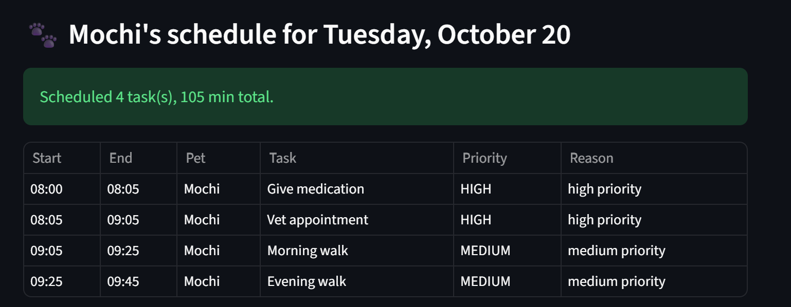
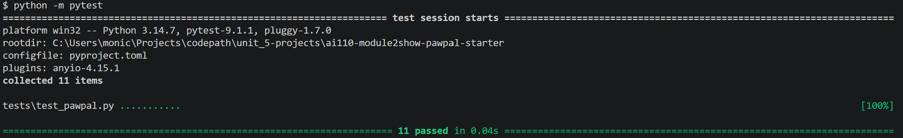

# PawPal+ (Module 2 Project)

You are building **PawPal+**, a Streamlit app that helps a pet owner plan care tasks for their pet.

## Scenario

A busy pet owner needs help staying consistent with pet care. They want an assistant that can:

- Track pet care tasks (walks, feeding, meds, enrichment, grooming, etc.)
- Consider constraints (time available, priority, owner preferences)
- Produce a daily plan and explain why it chose that plan

Your job is to design the system first (UML), then implement the logic in Python, then connect it to the Streamlit UI.

## What you will build

Your final app should:

- Let a user enter basic owner + pet info
- Let a user add/edit tasks (duration + priority at minimum)
- Generate a daily schedule/plan based on constraints and priorities
- Display the plan clearly (and ideally explain the reasoning)
- Include tests for the most important scheduling behaviors

## Getting started

### Setup

```bash
python -m venv .venv
source .venv/bin/activate  # Windows: .venv\Scripts\activate
pip install -r requirements.txt
```

### Suggested workflow

1. Read the scenario carefully and identify requirements and edge cases.
2. Draft a UML diagram (classes, attributes, methods, relationships).
3. Convert UML into Python class stubs (no logic yet).
4. Implement scheduling logic in small increments.
5. Add tests to verify key behaviors.
6. Connect your logic to the Streamlit UI in `app.py`.
7. Refine UML so it matches what you actually built.

## 🖥️ Sample Output

Paste a sample of your app's CLI or Streamlit output here so a reader can see what a generated plan looks like:


```
# e.g.:
# Daily plan for Biscuit (Golden Retriever):
#   08:00 — Morning walk (30 min) [priority: high]
#   09:00 — Feeding (10 min) [priority: high]
#   ...
```

## 🧪 Testing PawPal+

```bash
# Run the full test suite:
pytest

# Run with coverage:
pytest --cov
```

Sample test output:

```
# Paste your pytest output here
```


## 📐 Smarter Scheduling

> Fill in once you've implemented scheduling logic.

| Feature | Method(s) | Notes |
|---------|-----------|-------|
| Task sorting | | e.g., by priority, duration |
| Filtering | | e.g., skip tasks if time runs out |
| Conflict handling | | e.g., overlapping time slots |
| Recurring tasks | | e.g., daily vs. weekly |

## 📸 Demo Walkthrough

Describe your app in numbered steps so a reader can follow along without watching a video:

1. **Launch the app.** Run the Streamlit app. The page opens with the title "🐾 PawPal+" and the caption "A pet care planning assistant: add pets and tasks, then build a daily schedule."
2. **Save an owner profile.** In the Owner section, fill in these fields:
    * The owner's name.
    * The minutes available today.
    * The day start and day end times.
    * Any preferred task categories, such as exercise, feeding, or health. You can also type extra categories as a comma-separated list.

    Click **Save owner**. If the day end isn't after the day start, the app shows an error. Until an owner is saved, the rest of the page stays hidden.
3. **Add your pets.** In the Pets section, enter a pet name and choose a species (dog, cat, or other). Click **Add pet**. Each pet appears in a summary line such as "Mochi (dog)". You can add several pets, and the app shows an error if a pet can't be added, for example because of a duplicate name.
4. **Pick a pet and a task.** In the Tasks section, choose which pet the task is for. Then choose a preset task, such as Morning walk, Feeding, Give medication, Grooming, Playtime, Litter box cleaning, or Vet appointment. Presets in your preferred categories are listed first. You can also choose "Other (add your own)..." and type a custom name.
5. **Adjust the task details.** Selecting a preset fills in sensible defaults, which you can change:

    * Duration in minutes.
    * Priority (low, medium, or high).
    * Category.
    * Frequency (once, daily, or weekly).
    * An optional fixed time if the task must happen at a specific time.

    Click **Add task** to attach it to the selected pet.
6. **Let preferences auto-fill tasks.** Preset tasks that match your preferred categories are added automatically to every pet. If you delete one of these for a pet, the app remembers and won't re-add it.
7. **Review and tweak current tasks.** The Current tasks list shows each pending task with its pet, duration, and frequency. You can change a task's priority from its dropdown or remove it with the 🗑️ button.
8. **Choose a day.** In Build Schedule, pick the date to plan for. It defaults to today.
9. **Generate the schedule.** Click **Generate schedule**. The app builds a plan from your available time, your day start and end times, and each task's priority and fixed time. It then shows:

    * A heading such as "Mochi & Luna's schedule for Tuesday, October 20".
    * A success message with the number of tasks scheduled and the total minutes.
    * A table of the scheduled tasks.
    * A warning listing any tasks skipped because of lack of time or a conflict.
10. **Read the explanation.** Open the **Plan explanation** expander to see why the scheduler chose and ordered the tasks the way it did.

**Screenshot or video** *(optional)*: <!-- Insert a screenshot or link to a demo video here -->
https://drive.google.com/file/d/10NFgEYDI2axn3bVjrjMakRYoKJiymXQN/view?usp=sharing
